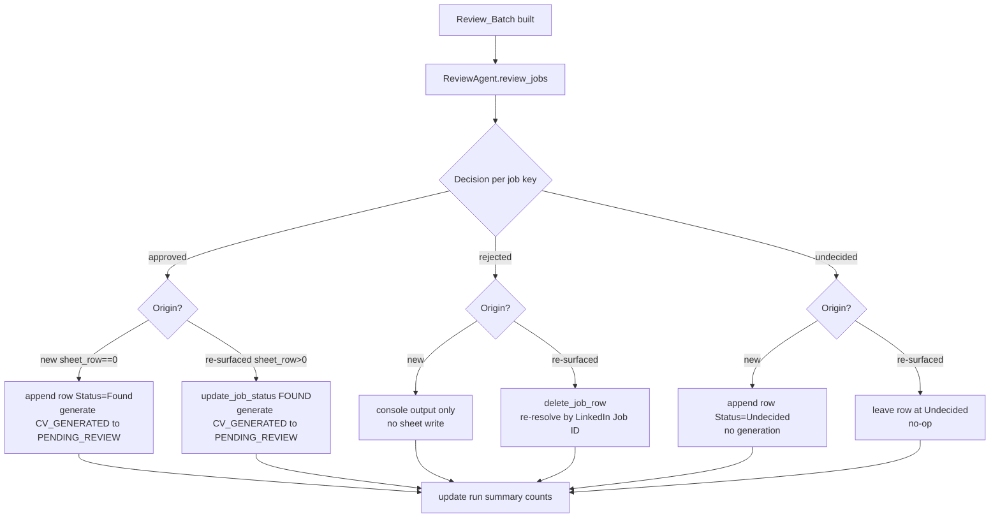

# Design Document

## Overview

This feature inserts a human review gate between job discovery and the logging/generation steps of the existing pipeline. Discovery already produces `JobListing` objects; today the orchestrator immediately appends every one to Google Sheets and generates documents. The review gate interrupts that flow: each job is pushed to Telegram as its own message with **Approve** and **Reject** inline buttons, the operator decides per job via long-polling (`getUpdates`), and jobs left undecided within a timeout resolve to a new `Undecided` status.

The design adds two new modules (`tools/telegram_tools.py`, `agents/review_agent.py`), extends two existing modules (`config/settings.py`, `models/job.py`), adds two functions to the sheets layer (`tools/sheets_tools.py` + `agents/sheets_agent.py`), and rewires the orchestrator's `run_search` and `_process_manual_async`. `run_full` is unchanged — it inherits the gate because it calls `run_search`.

The design deliberately keeps `tools/telegram_tools.py` as a thin HTTP wrapper with no business logic, and concentrates all gate logic (batch building, decision resolution, timeout handling) in `agents/review_agent.py`, mirroring the existing split between `tools/*` (I/O primitives) and `agents/*` (coordination).

**Language:** Python 3.11 (matches existing codebase — `str | None` unions, dataclasses, `enum`).

## Architecture & Data Flow

```
discovery (JobSearchAgent / manual scrape)
        │  list[JobListing]
        ▼
Orchestrator  ──(search/full)── merge new + Undecided rows ──► Review_Batch (dedup by LinkedIn Job ID)
        │                                                          │
        │  (process: scraped pasted-URL jobs only)                │
        ▼                                                          ▼
             ReviewAgent.review_jobs(batch, summarize_fn, telegram_client, timeout)
                   │                 │                      │
                   │                 │ Summary_Service      │ Telegram_Client (getUpdates long-poll)
                   │                 ▼                      ▼
                   │          DeepSeek client        send_message / poll_updates / answer_callback
                   ▼
             dict[key -> Decision]  (approved | rejected | undecided)
                   │
                   ▼
        Orchestrator branches per (origin, decision):
             new+approve   → append(Found) + generate (CV_GENERATED → PENDING_REVIEW)
             new+timeout   → append(Undecided)
             new+reject    → console only
             undecided+approve → update_job_status(FOUND) + generate
             undecided+reject  → delete_job_row (safe, id-resolved)
             undecided+timeout → leave as-is
```

**Origin** matters as much as decision. A job carries origin implicitly through `JobListing.sheet_row`: a brand-new job has `sheet_row == 0` (not yet in the sheet); a re-surfaced undecided job has a non-zero `sheet_row` loaded by `get_undecided_jobs`. The orchestrator uses this to pick the correct branch.

### Decision branching flowchart



*(process flow uses only the three brand-new branches: approve → append/generate, reject → console, timeout → append Undecided. process never reads undecided rows.)*

## Components and Responsibilities

| Component | File | Responsibility |
|---|---|---|
| ApplicationStatus.UNDECIDED | `models/job.py` | New enum value `"Undecided"` for deferred jobs. |
| Config fields | `config/settings.py` | Expose `telegram_bot_token`, `telegram_chat_id`, `review_timeout_seconds`. |
| Telegram_Client | `tools/telegram_tools.py` (new) | Thin Bot API wrapper: send message with inline buttons, poll `getUpdates` with offset, `answerCallbackQuery`. No business logic. |
| Review_Gate | `agents/review_agent.py` (new) | Build/receive the Review_Batch, send one message per job, poll until all decided or timeout, return `{key: Decision}`. |
| Summary_Service | `agents/review_agent.py` (`make_summarize_fn`) | DeepSeek-backed JD summary with truncated-excerpt fallback. |
| Sheets_Logger additions | `tools/sheets_tools.py` + `agents/sheets_agent.py` | `get_undecided_jobs`, `delete_job_row` (safe id-resolved, bottom-first for batches). |
| Orchestrator wiring | `agents/orchestrator.py` | Instantiate client + summarize_fn; merge batch; branch per (origin, decision); update summary counts. |
| HTTP dependency | `requirements.txt` | Add `requests` (chosen below). |

## Detailed Design

### 1. `models/job.py` — new status

```python
class ApplicationStatus(str, Enum):
    FOUND = "Found"
    CV_GENERATED = "CV Generated"
    PENDING_REVIEW = "Pending Review"
    APPROVED = "Approved"
    APPLYING = "Applying"
    APPLIED = "Applied"
    REJECTED = "Rejected"
    ERROR = "Error"
    UNDECIDED = "Undecided"   # NEW
```

`get_all_jobs` already round-trips `Status` through `ApplicationStatus(record.get("Status", ...))`, so `Undecided` rows parse automatically once the value exists. The status table in `run_status` is cosmetic; adding `UNDECIDED: "magenta"` to its `status_colors` is optional and does not affect correctness. *(Validates: Requirement 10.1)*

### 2. `config/settings.py` — configuration wiring

Add three fields to the `Config` dataclass and `Config.load()`, following the existing `_require`/`os.getenv` pattern:

```python
@dataclass
class Config:
    ...
    telegram_bot_token: str
    telegram_chat_id: str
    review_timeout_seconds: int

    @classmethod
    def load(cls) -> "Config":
        return cls(
            ...
            telegram_bot_token=_require("TELEGRAM_BOT_TOKEN"),
            telegram_chat_id=_require("TELEGRAM_CHAT_ID"),
            review_timeout_seconds=int(os.getenv("REVIEW_TIMEOUT_SECONDS", "3600")),
        )
```

`TELEGRAM_BOT_TOKEN` and `TELEGRAM_CHAT_ID` are mandatory for the gate, so they use `_require` (raises on absence, consistent with other credentials). `review_timeout_seconds` has a safe default of 3600, so it uses `int(os.getenv(..., "3600"))`. *(Validates: Requirements 7.1, 7.2, 7.3)*

### 3. `tools/telegram_tools.py` (NEW) — thin Bot API wrapper

**HTTP library choice:** `requests`. The existing codebase is predominantly synchronous outside the Playwright scraping paths, and the review gate runs synchronously between discovery and generation. `requests` is the simplest fit and is widely trusted. Added to `requirements.txt` as `requests>=2.31.0`. *(Validates: Requirement 11.1)*

The module holds no gate logic — only payload construction and HTTP calls against `https://api.telegram.org/bot{token}/{method}`.

#### Function signatures

```python
BASE_URL = "https://api.telegram.org/bot{token}/{method}"

def send_review_message(
    token: str,
    chat_id: str,
    text: str,
    job_key: str,
) -> int:
    """POST sendMessage with two inline-keyboard buttons (Approve/Reject).
    callback_data encodes the per-job key. Returns the Telegram message_id."""

def poll_updates(
    token: str,
    offset: int | None = None,
    timeout: int = 25,
) -> list[dict]:
    """GET/POST getUpdates with long-poll `timeout`. Returns the raw `result`
    list of update objects. Caller advances `offset` using update_id."""

def answer_callback(
    token: str,
    callback_query_id: str,
    text: str = "",
) -> None:
    """POST answerCallbackQuery to acknowledge a button tap (stops the
    client-side spinner). Best-effort; failures are swallowed."""
```

#### Payload shapes

`sendMessage` request body:

```json
{
  "chat_id": "<chat_id>",
  "text": "<title / company / summary>",
  "reply_markup": {
    "inline_keyboard": [[
      {"text": "✅ Approve", "callback_data": "a|<job_key>"},
      {"text": "❌ Reject",  "callback_data": "r|<job_key>"}
    ]]
  }
}
```

`callback_data` encodes `"<action>|<job_key>"` where action is `a` (approve) or `r` (reject). Telegram caps `callback_data` at 64 bytes; job keys (numeric LinkedIn IDs or short synthesized hashes — see §4) stay well within that. Encoding/decoding is a pure pair of helpers (`encode_callback`, `decode_callback`) living in this module since they define the wire format, but they contain no gate logic.

`getUpdates` response (`result[]`) for a button tap contains a `callback_query` object:

```json
{
  "update_id": 123456789,
  "callback_query": {
    "id": "<callback_query_id>",
    "data": "a|3904567890",
    "message": {"message_id": 42}
  }
}
```

#### Offset and ack handling

- Each update carries a monotonically increasing `update_id`. After processing a batch of updates, the caller passes `offset = max(update_id) + 1` to the next `poll_updates` call. Telegram then drops all updates with `update_id < offset`, so each update is delivered exactly once and no tap is double-counted.
- On receiving a `callback_query`, the gate calls `answer_callback(token, callback_query.id)` to stop the operator's button spinner. Ack failures are logged and ignored — they never block decision resolution.

*(Validates: Requirements 2.1, 2.3, 6.1, 6.2)*

### 4. `agents/review_agent.py` (NEW) — review coordinator

#### Decision representation

```python
from enum import Enum

class Decision(str, Enum):
    APPROVED = "approved"
    REJECTED = "rejected"
    UNDECIDED = "undecided"
```

A `str`-backed enum matches `ApplicationStatus` and makes mapping to sheet status trivial.

#### Per-job key

```python
def job_key(job: JobListing) -> str:
    if job.linkedin_job_id:
        return job.linkedin_job_id
    # process jobs may lack a numeric ID (non-digit URL slug → "")
    raw = f"{job.url}|{job.title}|{job.company}"
    return "k" + hashlib.sha1(raw.encode()).hexdigest()[:12]
```

LinkedIn Job ID is the natural key — it already de-duplicates against the sheet (`job_already_tracked`) and matches rows across runs. But process jobs can have an empty `linkedin_job_id` (the orchestrator sets it to `""` when the URL slug is non-numeric). For those we synthesize a stable key from URL+title+company so the key is deterministic within a run, fits `callback_data`, and never collides with a real numeric LinkedIn ID (the `"k"` prefix guarantees that). *(Validates: Requirement 4.2)*

#### `review_jobs`

```python
def review_jobs(
    jobs: list[JobListing],
    summarize_fn: Callable[[JobListing], str],
    telegram_client,          # module or object exposing the 3 tool functions, bound to token/chat_id
    timeout: int,
    now_fn: Callable[[], float] = time.monotonic,   # injectable clock for tests
) -> dict[str, Decision]:
    """Send one message per job, long-poll until all keys decided or the
    timeout elapses. Keys still undecided at timeout → Decision.UNDECIDED."""
```

Behaviour:
1. Build `keys = {job_key(j): j for j in jobs}`. Sending uses one message per distinct key, so the dedup done upstream (§6) means one message per job. *(Req 2.1)*
2. For each job, compute `text = render_message(job.title, job.company, summarize_fn(job))` and call `send_review_message(..., job_key=key)`. `render_message` is a pure helper that always includes title, company, and summary. *(Req 2.2)*
3. Initialise `decisions = {}` and `deadline = now_fn() + timeout`.
4. Loop while `len(decisions) < len(keys)` and `now_fn() < deadline`:
   - `updates = poll_updates(token, offset)` with a bounded long-poll timeout (clamped so it never overruns the deadline).
   - For each update with a `callback_query`: `action, key = decode_callback(data)`; if `key` is in our batch and not yet decided, set `decisions[key] = APPROVED/REJECTED`; `answer_callback(...)`; advance `offset = update_id + 1`.
5. After the loop, any key not in `decisions` → `Decision.UNDECIDED`. Return `decisions`. *(Reqs 2.4, 6.3)*

The injectable `now_fn` lets property/unit tests cross the timeout boundary deterministically without real sleeping.

#### Summary_Service — `make_summarize_fn`

```python
def make_summarize_fn(client: OpenAI, model: str, excerpt_chars: int = 600):
    def summarize(job: JobListing) -> str:
        jd = job.job_description or ""
        try:
            resp = client.chat.completions.create(
                model=model,
                messages=[
                    {"role": "system", "content": "Summarise this job's responsibilities and key requirements in 3-4 short lines."},
                    {"role": "user", "content": jd[:6000]},
                ],
                max_tokens=300,
            )
            text = (resp.choices[0].message.content or "").strip()
            if text:
                return text
        except Exception:
            pass
        # Fallback: truncated excerpt so the message always sends.
        excerpt = jd.strip()[:excerpt_chars]
        return excerpt or "(no description available)"
    return summarize
```

Built on the same DeepSeek `OpenAI` client the orchestrator already constructs (`base_url=https://api.deepseek.com`), using the lightweight `config.model` (not the heavier `document_model`). On any LLM failure — exception or empty content — it returns a bounded truncated excerpt of the JD, guaranteeing a non-empty summary so the Telegram message still sends. *(Validates: Requirements 8.1, 8.2)*

### 5. Sheets layer — undecided retrieval & safe deletion

#### `tools/sheets_tools.py`

```python
def get_undecided_jobs(ws) -> list[JobListing]:
    return [j for j in get_all_jobs(ws) if j.status == ApplicationStatus.UNDECIDED]

def delete_job_row(ws, linkedin_job_id: str) -> bool:
    """Re-resolve the row by LinkedIn Job ID immediately before deleting,
    then delete it. Returns True if a row was deleted."""
    if not linkedin_job_id:
        return False
    id_col = HEADERS.index("LinkedIn Job ID") + 1
    col_values = ws.col_values(id_col)          # fresh read, right before delete
    for row_num, val in enumerate(col_values, start=1):
        if val == linkedin_job_id:
            ws.delete_rows(row_num)             # gspread delete_rows(start[, end])
            return True
    return False
```

`get_undecided_jobs` reuses `get_all_jobs` (which already carries `sheet_row`), so re-surfaced jobs arrive with a non-zero `sheet_row` the orchestrator reads as "origin = re-surfaced". *(Validates: Requirement 4.1 — retrieval half)*

`delete_job_row` always re-reads the ID column immediately before deleting rather than trusting any previously cached `sheet_row`, because other deletions earlier in the same run shift indices. It matches by LinkedIn Job ID and deletes exactly that row via gspread's `delete_rows(start_index, end_index=None)` (1-based, inclusive). *(Validates: Requirements 9.1, 9.2)*

#### Batch deletion ordering

The orchestrator may reject several undecided jobs in one run. To avoid index-shift bugs, batch deletion resolves all target rows, then deletes **bottom-most-first** (descending row number). Because `delete_job_row` re-resolves by ID on each call, calling it per rejected job is already safe; when deleting a known set in one pass the orchestrator sorts resolved rows descending before deleting. *(Validates: Requirement 9.3)*

#### `agents/sheets_agent.py`

```python
def get_undecided_jobs(self) -> list[JobListing]:
    return sheets_tools.get_undecided_jobs(self.ws)

def delete_job_row(self, linkedin_job_id: str) -> bool:
    return sheets_tools.delete_job_row(self.ws, linkedin_job_id)
```

Approve-update reuses the existing `update_job_status(job, ApplicationStatus.FOUND)` — no new method needed for the undecided→Found transition.

### 6. `agents/orchestrator.py` — wiring the gate

#### `__init__`

```python
from tools import telegram_tools
from agents.review_agent import make_summarize_fn, review_jobs, job_key
from functools import partial

self.telegram = partial_client(config.telegram_bot_token, config.telegram_chat_id)
self.summarize_fn = make_summarize_fn(self.client, config.model)
```

The Telegram "client" is the `telegram_tools` module bound to the configured token/chat_id (via a tiny adapter object or `functools.partial`-wrapped callables). `summarize_fn` is built from the existing DeepSeek `self.client`.

#### `run_search`

1. `undecided = self.sheets.get_undecided_jobs()` (origin = re-surfaced; each has `sheet_row > 0`).
2. `new_jobs = self.job_search.run(...)` (origin = brand-new; `sheet_row == 0`).
3. **Merge + dedup** into one batch keyed by LinkedIn Job ID. A job present in both sets (same non-empty id) is kept **once**, preferring the undecided entry (it carries `sheet_row`, so origin stays "re-surfaced" and the operator's reject can delete it). Jobs with empty ids are kept as-is.
4. If the batch is empty, print "nothing to review" and return.
5. `decisions = review_jobs(batch, self.summarize_fn, self.telegram, self.config.review_timeout_seconds)`.
6. Branch per job by `(origin, decision)` where `origin = "resurfaced" if job.sheet_row else "new"`:
   - **new + approved** → `append_jobs([job])`, then existing generation loop (`CV_GENERATED` → generate → `PENDING_REVIEW`, `ERROR` on failure).
   - **new + undecided** → `append_jobs([job])` then `update_job_status(job, UNDECIDED)`; no generation.
   - **new + rejected** → console line only; no sheet write.
   - **resurfaced + approved** → `update_job_status(job, FOUND)`, then generation loop.
   - **resurfaced + rejected** → collect for bottom-first batch delete via `delete_job_row(job.linkedin_job_id)`.
   - **resurfaced + undecided** → no-op (row already `Undecided`).
7. Update the end-of-run summary with **approved / rejected / undecided** counts (extend `_print_summary` or print a counts line).

*(Validates: Requirements 1.1, 1.2, 1.4, 3.1, 3.2, 3.3, 4.1, 4.2, 4.3, 4.4, 4.5)*

#### `run_process` / `_process_manual_async`

Preserve the existing per-URL scraping and its recruiter / unavailable / scrape-error handling, which marks rows `Error` **before** review. Then:

1. Collect successfully scraped `JobListing` objects into `scraped: list[JobListing]` (do **not** append/generate inline anymore). These are the only jobs reviewed — no undecided rows are read. *(Reqs 5.1, 5.2)*
2. `decisions = review_jobs(scraped, self.summarize_fn, self.telegram, self.config.review_timeout_seconds)`.
3. Branch using **brand-new rules only** (process jobs are always treated as new even though a manual row already exists — the gate decides whether to fill/generate):
   - **approved** → `fill_manual_row` + `update_job_status(CV_GENERATED)` + generate → `PENDING_REVIEW` (existing logic, now gated).
   - **rejected** → console output only; leave the manual row untouched (operator can delete it).
   - **undecided** (timeout) → `update_job_status(job, UNDECIDED)` and log Undecided; no generation.

Scrape failures still mark `Error` and `continue` before any review, exactly as today. *(Validates: Requirements 1.3, 3.1–3.3 analogue, 5.1, 5.2)*

#### `run_full`

Unchanged. It calls `run_search`, so it inherits the gate and undecided re-review automatically. *(Validates: Requirement 1.2)*

## Error Handling

- **Telegram send failure:** if `send_review_message` raises for a job, log the error and resolve that job as `UNDECIDED` (it cannot be presented, so it must not be silently approved/rejected). This keeps the job for the next run.
- **Telegram poll failure:** transient `getUpdates` errors are caught inside the `review_jobs` loop and retried on the next iteration; the offset is only advanced for updates actually processed, so no decision is lost or duplicated.
- **answerCallbackQuery failure:** best-effort; swallowed. The decision is already recorded regardless of ack.
- **Summary failure:** handled inside `summarize_fn` — always returns a non-empty truncated excerpt, so a message always sends (Req 8.2).
- **Scrape failures (process):** continue to mark the row `Error` and skip it **before** the review step, exactly as the current code does. These jobs never enter the Review_Batch.
- **Generation failure after approval:** unchanged — status set to `ERROR` with the exception in Notes.
- **Delete miss:** `delete_job_row` returns `False` if the id is no longer present (already deleted/edited); the orchestrator logs and continues.

## Correctness Properties

*A property is a characteristic or behavior that should hold true across all valid executions of a system — a formal statement about what the system should do. Properties bridge human-readable specifications and machine-verifiable correctness guarantees.*

### Property 1: Batch merge is the deduplicated union keyed by LinkedIn Job ID

For any set of brand-new jobs and any set of undecided jobs, the merged Review_Batch contains every distinct job from both sets, and every non-empty LinkedIn Job ID appears at most once; when the same id appears in both sets, the re-surfaced (sheet-backed) entry is the one retained.

**Validates: Requirements 4.1, 4.2**

### Property 2: Branch dispatch acts only according to (origin, decision)

For any Review_Batch and any decision map, the orchestrator's dispatch performs exactly the actions mandated by each job's (origin, decision) pair and no others: rejected brand-new jobs cause zero sheet writes; brand-new timeouts append with status `Undecided` and trigger no generation; re-surfaced timeouts cause zero sheet mutations; and no job that remains pending (undecided before resolution) is ever logged or generated.

**Validates: Requirements 1.4, 3.2, 3.3, 4.5**

### Property 3: One message per job

For any Review_Batch of jobs with distinct keys, `review_jobs` sends exactly one Telegram message per job (send count equals the number of distinct keys).

**Validates: Requirement 2.1**

### Property 4: Message body contains title, company, and summary

For any job and any summary string, the rendered message body contains the job title, the company name, and the summary text.

**Validates: Requirement 2.2**

### Property 5: Message payload carries both buttons and a round-tripping key

For any job key, the constructed `sendMessage` payload attaches exactly two inline buttons (Approve and Reject), and decoding each button's `callback_data` recovers the original job key and its action.

**Validates: Requirements 2.3, 2.4**

### Property 6: Button taps resolve to the matching decision

For any set of callback updates mapping job keys to Approve/Reject actions, `review_jobs` resolves each tapped key to the Decision matching its action, and leaves untapped keys for timeout handling.

**Validates: Requirement 2.4**

### Property 7: getUpdates offset is monotonic and exactly-once

For any sequence of updates, after processing them the next poll offset equals `max(update_id) + 1`, and no update is processed more than once across polls.

**Validates: Requirement 6.1**

### Property 8: Timeout resolves exactly the undecided keys

For any partition of a batch into decided and never-decided keys, with a clock that crosses the deadline, `review_jobs` returns `UNDECIDED` for every never-decided key and preserves the recorded decision for every decided key.

**Validates: Requirement 6.3**

### Property 9: Summary fallback always yields a non-empty bounded excerpt

For any job description, when the DeepSeek client fails or returns empty content, `summarize_fn` returns a non-empty string that is a prefix-bounded excerpt of the job description (length ≤ `excerpt_chars`), so a message can always be sent.

**Validates: Requirements 8.1, 8.2**

### Property 10: Safe bottom-first deletion removes exactly the targets

For any sheet contents and any set of target LinkedIn Job IDs present in it, deleting those rows (each re-resolved by id, bottom-most-first) leaves exactly the non-target rows intact, regardless of the targets' original row order.

**Validates: Requirements 9.1, 9.3**

## Testing Strategy

Hypothesis is already a project dependency (`hypothesis>=6.0.0`), and `pytest` is present, so property-based tests run with the existing toolchain. The feature breaks down into 7 implementation tasks, each with its own tests.

**Dual approach:** property tests cover the universal invariants above; example/unit tests cover specific wiring, config, and edge cases. Property tests run ≥100 iterations and are tagged `Feature: telegram-review-gate, Property {n}: {text}`.

| Task | Scope | Tests |
|---|---|---|
| 1 | `models/job.py` + `config/settings.py` + `requirements.txt` | Example: `ApplicationStatus("Undecided")` round-trip (Req 10.1); `Config.load()` reads token/chat_id and defaults timeout to 3600 (Reqs 7.1–7.3); smoke: `requests` listed in requirements.txt (Req 11.1). |
| 2 | `tools/telegram_tools.py` payloads + offset | Property 5 (payload buttons + callback round-trip), Property 7 (offset monotonic/exactly-once) with synthetic update lists; unit: HTTP calls mocked, no webhook used (Req 6.2). |
| 3 | Summary_Service | Property 9 (fallback bounded excerpt) with a failing fake client; integration-style unit: happy path returns LLM text with a fake client (Req 8.1). |
| 4 | `review_agent.review_jobs` | Property 3 (one message per job), Property 4 (body content), Property 6 (tap resolution), Property 8 (timeout resolution via injected `now_fn`); unit: send-failure → UNDECIDED. |
| 5 | Sheets `get_undecided_jobs` / `delete_job_row` | Property 10 (safe bottom-first deletion) over a fake worksheet; example: re-resolution after row shift (Req 9.2); unit: `get_undecided_jobs` filters by status. |
| 6 | Batch build + branch dispatch (search/full) | Property 1 (merge+dedup), Property 2 (branch dispatch) with fake sheets + fake Telegram client asserting per-branch actions; integration: new/resurfaced × approve/reject/timeout matrix (Reqs 3.1–4.5). |
| 7 | process wiring | Integration: process reviews only scraped jobs, never calls `get_undecided_jobs` (Reqs 5.1, 5.2); scrape errors mark `Error` before review; approve/reject/timeout branch assertions. |

**Not property-tested (per guidance):** Telegram Bot API behavior itself, webhook-absence (configuration/smoke), and the orchestrator's end-to-end ordering (integration with fakes). Config reads and the enum value are deterministic single checks (example tests).

## Requirements Traceability

| Requirement | Design section |
|---|---|
| 1.1, 1.2, 1.4 | Architecture & Data Flow; §6 run_search; run_full |
| 1.3 | §6 run_process |
| 2.1, 2.2, 2.3, 2.4 | §3 Telegram tools; §4 review_jobs / render_message |
| 3.1, 3.2, 3.3 | §6 run_search branch table; flowchart |
| 4.1, 4.2 | §5 get_undecided_jobs; §6 merge+dedup; §4 job_key |
| 4.3, 4.4, 4.5 | §6 run_search branch table |
| 5.1, 5.2 | §6 run_process scope boundary |
| 6.1, 6.2 | §3 offset/ack handling |
| 6.3 | §4 review_jobs timeout loop |
| 7.1, 7.2, 7.3 | §2 config wiring |
| 8.1, 8.2 | §4 make_summarize_fn |
| 9.1, 9.2, 9.3 | §5 delete_job_row + batch ordering |
| 10.1 | §1 ApplicationStatus.UNDECIDED |
| 11.1 | §3 HTTP library choice |
